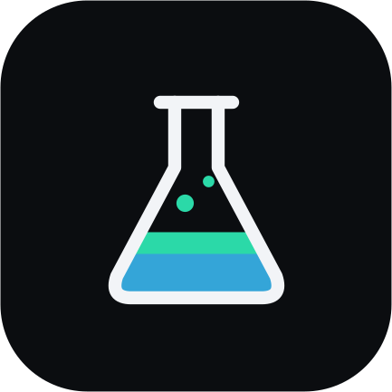
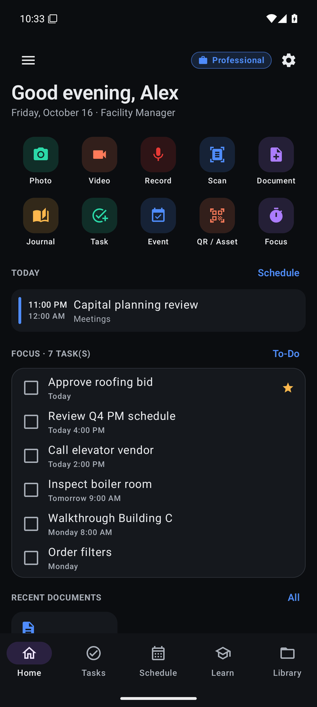
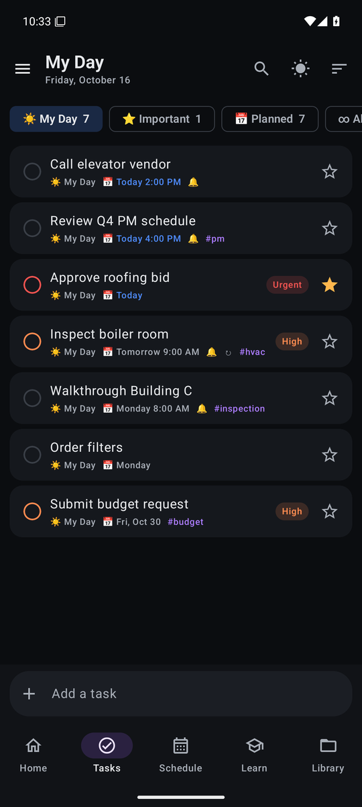
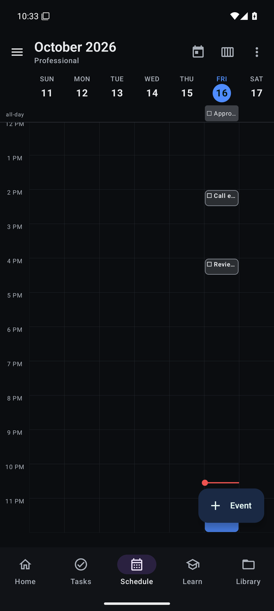
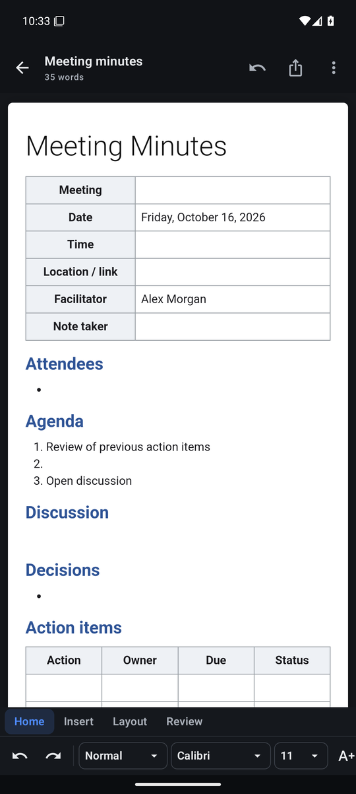
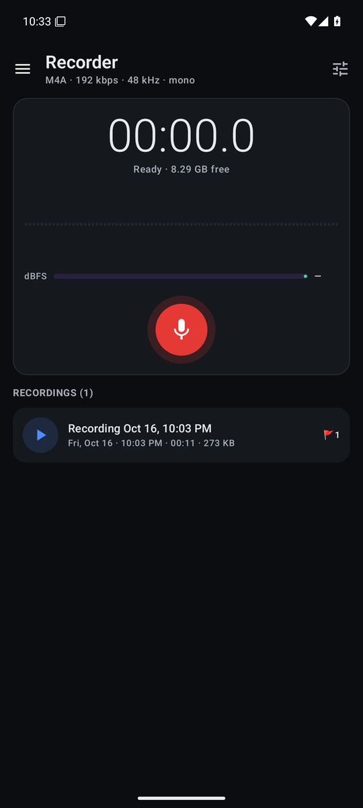

<div align="center">



# BlackLab

**A private, all-in-one personal & professional workspace for Android.**
Pro camera · audio recorder · Word-class documents · journal · to-do · calendar · education & certification tracking — in one app, with every file saved to a real folder on your phone.

[](CHANGELOG.md)
[](#requirements)
[](https://kotlinlang.org)
[](https://developer.android.com/compose)
[](https://github.com/paulmmoore3416/BlackLab/actions/workflows/android.yml)

[Download APK](releases/BlackLab-v3.0.0.apk) · [Features](#features) · [Install](#install) · [Build from source](#build-from-source) · [Architecture](docs/ARCHITECTURE.md)

</div>

---

<p align="center">
  
  
  
  
  
</p>

## Why BlackLab

BlackLab is designed for people who run complex operations by day and keep learning on the side — originally built around the daily workflow of a **facility operations leader** who is also enrolled in college and certification programs. It replaces a handful of apps with one coherent workspace that:

- keeps **Personal** and **Professional** accounts completely separate (data, folders, calendars, accents, optional biometric lock),
- stores **everything as real files** in `Internal storage › BlackLab` — readable in the Files app, on a PC over USB, and kept across reinstalls,
- works **offline** with no account, no cloud service and no analytics of its own.

Optimized for the **Google Pixel 10 Pro XL** and newer (Android 15+).

## Features

### 📷 Camera
- CameraX pipeline with **Night**, **Portrait (bokeh)** and **HDR** extension modes when the device supports them
- **Ultra HDR** (JPEG_R) photos and optional **maximum-resolution** capture (full sensor)
- **4K / 1080p / 720p** video at 24/30/**60 fps**, **10-bit HLG HDR video**, preview & video **stabilization**
- Tap-to-focus/meter, exposure compensation, pinch & preset zoom (ultra-wide → telephoto), flash/torch, grid, 3 s/10 s timer, 4:3 / 16:9
- **Document scanner** (edge detection, perspective correction → PDF) and **QR / barcode scanner** for asset tags, both on-device via Google Play services
- **OCR** — extract text from any photo into an editable document

### 🎙️ Recorder
- `AudioRecord` engine with real-time **AAC (M4A)** encoding or **lossless WAV** (16 – 96 kHz, mono/stereo, 64 – 320 kbps)
- Microphone source (standard, directional, voice, meeting/echo-cancel, raw, performance) and **input device** selection (built-in, USB, Bluetooth)
- **Noise suppression, auto gain, echo cancellation**, digital gain boost (+24 dB)
- Live waveform & dBFS meter, pause/resume, **markers** (Action item / Decision / Question), background recording with notification controls
- **On-device live transcription** (beta) fed from the same audio stream, plus post-recording transcription; save transcripts as documents
- Playback at 0.5×–3×, ±10 s/30 s skip, marker jump

### 📝 Documents — Word-class editor
- Ribbon toolbar (**Home · Insert · Layout · Review**, contextual **Table** and **Picture** tabs)
- Styles (Title, Heading 1–4, Quote, Code), 13 fonts, sizes 8–72, bold/italic/underline/strike, super/subscript, text color & highlight, clear formatting
- Bullets, numbering, **checklists**, indent/outdent, alignment incl. justify, line spacing
- **Tables** (insert, add/delete rows & columns, header row), **images** (resize, align), links, horizontal rules, **page breaks**, date/time, symbols
- **Find & replace**, word count & reading time, **dictation**, **read aloud**
- Page setup: Letter / A4 / Legal / A5, portrait/landscape, margins
- **Export to DOCX, PDF, HTML, Markdown, TXT**; system **Print / Save as PDF**; **import DOCX, Markdown, HTML, RTF, TXT**
- 19 templates including **Memo, Meeting minutes, Work order, Incident report, SOP, Facility inspection, PM log, Project brief, Vendor evaluation, Budget request, Weekly status, Shift handover, Cornell notes**

### 📔 Journal
Rich-text entries saved as dated files, mood tracking, tags & location, favorites, **prompt of the day** (separate personal/professional sets), streaks, monthly calendar, “On this day”, and templates (daily reflection, gratitude, work log, lessons learned, goals, study log).

### ✅ To-Do (Microsoft To Do + Google Tasks + Any.do)
- **My Day**, **Important**, **Planned**, custom lists with emoji & color, **Plan my day** suggestions
- **Natural-language quick add** — `Inspect boiler room tomorrow 9am !high #hvac every week @Inspections`
- Steps (subtasks), due date & time, reminders with **Complete / Snooze** notification actions, repeat rules, priorities, tags, time estimates, notes, attachments
- Smart grouping (Overdue / Today / Tomorrow / Next 7 days / Later), swipe to complete or delete with undo, search & sorting

### 📅 Schedule
- **Month, Week, 3-Day, Day** time grids and **Agenda**; swipe between periods; tap a slot to create
- Recurring events (daily → yearly, custom weekdays, end date / count, edit or delete single occurrences), multiple reminders, calendars with colors, meeting links, attendees, free/busy
- **Conflict detection**, **Find a time** (free blocks within working hours)
- Overlays **phone calendars (Google, Outlook/Exchange)**, dated tasks, classes, assignments and exams; optional overlay of the other account
- **.ics import/export** and one-tap “send to Google Calendar”
- Morning **agenda notification**

### 🎓 Education
- Terms, courses (college, certification prep, training, workshop, online), instructors, office hours, LMS links, class meeting times on the calendar
- Assignments & exams with weighted **grade categories**, current grade, **“needed on the rest”** calculator
- **GPA** (cumulative, per term, projected) with **what-if** calculator and degree-credit progress
- **Certifications & credentials** (CFM, FMP, SFP, CEM, LEED, PMP, OSHA…) with exam dates, renewal reminders at 90/30/7 days and a **CEU/PDH log**
- **Pomodoro focus timer** that survives app restarts, study-time analytics and weekly goals
- **Flashcards** with SM-2 spaced repetition

### 🔐 Accounts, privacy & storage
- Personal / Professional accounts with separate data and folders; default account at launch
- Optional **biometric / device-credential lock** for the app and/or the Professional account
- Daily automatic **backups** of the database & settings to `BlackLab/Backups` (14 kept) with one-tap restore
- BlackLab has no backend, no account and no analytics of its own; your content never leaves the device unless you share or export it

## Storage layout

```
Internal storage/BlackLab/
├── Personal/ · Professional/
│   ├── Photos/        Camera photos (Ultra HDR JPEG)
│   ├── Videos/        Camera videos (MP4)
│   ├── Recordings/    Audio (M4A / WAV) + transcripts (.txt)
│   ├── Scans/         Document scans (PDF + page images)
│   ├── Documents/     Documents as .html (open in any browser or Word)
│   ├── Journal/       Entries by year/month
│   ├── Education/     Certificates, syllabi
│   ├── Exports/       DOCX / PDF / MD / TXT / ICS exports
│   └── Imports/       Files shared or imported into BlackLab
└── Backups/           Automatic database backups (.zip)
```

## Install

1. Download **[`BlackLab-v3.0.0.apk`](releases/BlackLab-v3.0.0.apk)** (also attached to the [v3.0.0 release](https://github.com/paulmmoore3416/BlackLab/releases/tag/v3.0.0)).
   Verify it with the published SHA-256: [`BlackLab-v3.0.0.apk.sha256`](releases/BlackLab-v3.0.0.apk.sha256).
2. On the phone, allow your browser/Files app to **install unknown apps** when prompted.
3. Open BlackLab and follow onboarding: name & title, account names, then grant
   **All-files access** (creates the BlackLab folder), **camera & microphone**, **notifications** and optionally **calendars**.

Or with USB debugging: `adb install releases/BlackLab-v3.0.0.apk`

### Requirements
- Android **15+** (API 35); targets Android 16 (API 36). Tested on an Android 16 emulator; installed and launched on a Pixel 10 Pro XL running Android 17
- Google Play services for the document scanner, code scanner and OCR
- Live transcription uses the on-device speech pack (Settings › System › Languages › Speech)

## Build from source

Requirements: **JDK 17+** (21 recommended) and the **Android SDK** (platform 36).

```bash
git clone https://github.com/paulmmoore3416/BlackLab.git
cd BlackLab
echo "sdk.dir=$HOME/Android/Sdk" > local.properties   # path to your SDK
./gradlew :app:assembleDebug        # app/build/outputs/apk/debug/
./gradlew :app:assembleRelease      # R8-optimized release build
```

Release signing reads `keystore/keystore.properties` (never committed). Without it, release builds fall back to the debug key, so anyone can build the project. To sign with your own key:

```properties
# keystore/keystore.properties
storeFile=your-release.jks
storePassword=…
keyAlias=…
keyPassword=…
```

> APKs signed with different keys can’t update each other. Keep your keystore safe and backed up.

## Tech stack

| Area | Technology |
|---|---|
| Language / UI | Kotlin 2.1, Jetpack Compose, Material 3 |
| Persistence | Room (SQLite), SharedPreferences, plain files in the BlackLab folder |
| Camera | CameraX 1.4 (core, video, extensions) |
| Audio | AudioRecord, MediaCodec AAC + MediaMuxer, audio effects, SpeechRecognizer |
| Media playback | Media3 ExoPlayer |
| Documents | WebView `contenteditable` editor, jsoup, custom OOXML (DOCX) writer/reader, native `PdfDocument` renderer |
| On-device ML | ML Kit document scanner, code scanner, text recognition (Play services) |
| Reminders | Exact alarms (single self-rescheduling alarm), notifications with actions |
| Security | AndroidX Biometric |

See **[docs/ARCHITECTURE.md](docs/ARCHITECTURE.md)** for the design.

## Project structure

```
app/src/main/java/com/blacklab/app/
├── core/        Profiles, settings, storage, time & recurrence, backups
├── data/        Room entities/DAOs, calendar logic, task ops, grades, SRS
├── docs/        HTML ⇄ blocks model, DOCX writer/reader, PDF writer, Markdown
├── recorder/    Audio engine, encoders, transcription, foreground service
├── reminders/   Alarm scheduler, receivers, notifications
├── study/       Pomodoro timer
└── ui/          Compose screens (home, camera, recorder, library, documents,
                 editor, journal, tasks, schedule, education, settings, onboarding)
```

## Privacy & security

BlackLab has no backend and collects no analytics of its own — documents, recordings, photos and your database stay on the device.

**Disclosure:** the document scanner, QR/barcode scanner and OCR run on-device through Google Play services (ML Kit). Those Google libraries add the `INTERNET` / `ACCESS_NETWORK_STATE` permissions and, per Google’s ML Kit terms, may send anonymous usage and performance metrics to Google. They do not upload your images or text.

Signing keys, passwords and machine-specific files are excluded from this repository by `.gitignore`. See [SECURITY.md](SECURITY.md).

## License

Copyright © 2026 Paul Moore. All rights reserved. See [LICENSE](LICENSE).
