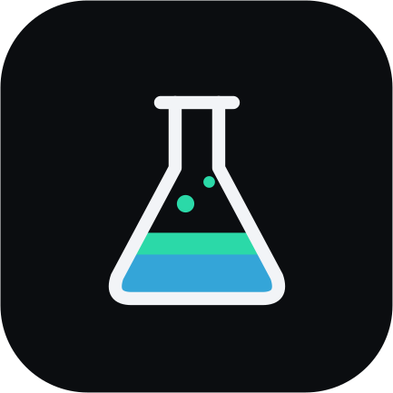
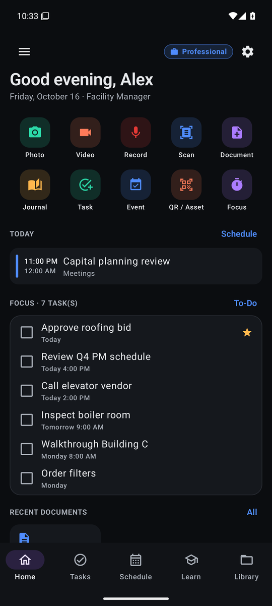
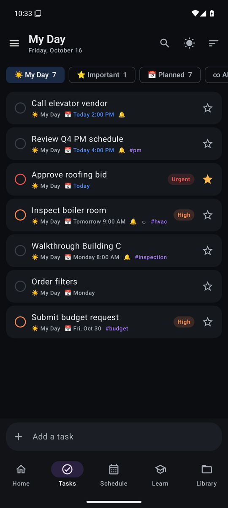
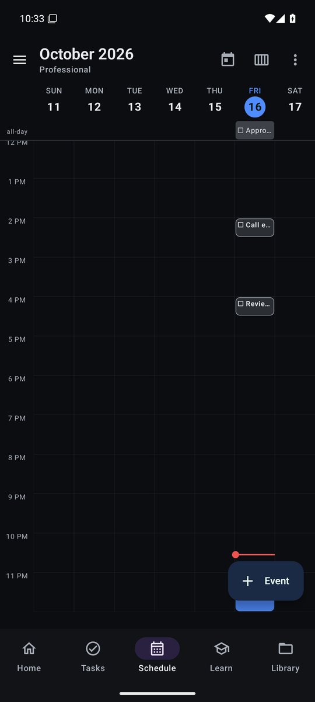
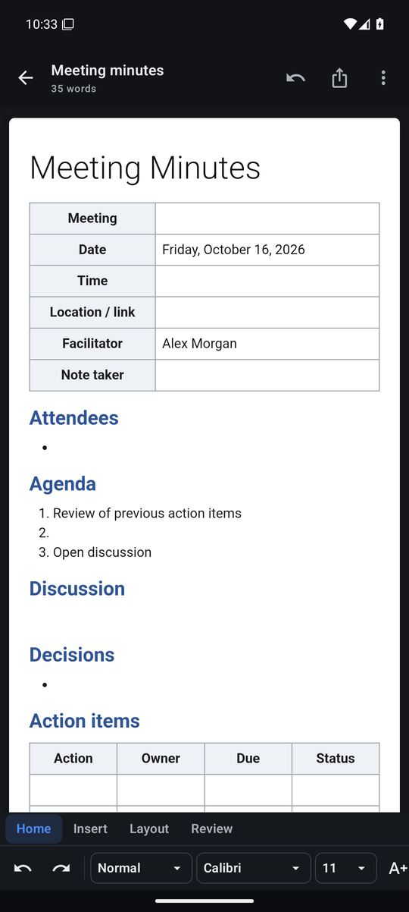
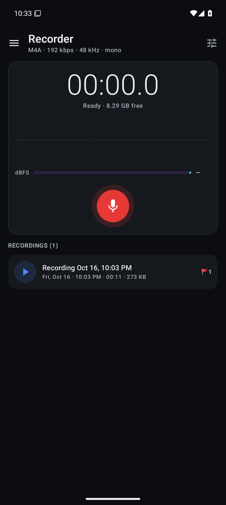

<div align="center">



# BlackLab

**A private, all-in-one personal & professional workspace for Android.**
Pro camera & photo editor · dictation · audio recorder · Word-class documents · journal · to-do · calendar · education & certification tracking — in one app, with every file saved to a real folder on your phone.

[](CHANGELOG.md)
[](#requirements)
[](https://kotlinlang.org)
[](https://developer.android.com/compose)
[](https://github.com/paulmmoore3416/BlackLab/actions/workflows/android.yml)

[Download APK](https://github.com/paulmmoore3416/BlackLab/releases/latest) · [Features](#features) · [Install](#install) · [Build from source](#build-from-source) · [Architecture](docs/ARCHITECTURE.md)

</div>

---

<p align="center">
  
  
  
  
  
</p>

## Why BlackLab

BlackLab is designed for people who run complex operations by day and keep learning on the side — originally built around the daily workflow of a **facility operations leader** who is also enrolled in college and certification programs. It replaces a handful of apps with one coherent workspace that:

- keeps **Personal** and **Professional** accounts completely separate (data, folders, calendars, accents, optional biometric lock),
- stores **everything as real files** in `Internal storage › BlackLab` — readable in the Files app, on a PC over USB, and kept across reinstalls,
- works **offline** with no account, no cloud service and no analytics of its own.

Optimized for the **Google Pixel 10 Pro XL** and newer (Android 15+).

## Features

### 🤖 Assistant
- Talk or type from the Home ask bar, a launcher shortcut, the Quick Settings tile, or hold power (set BlackLab as the digital assistant)
- **Works offline**: an on-device command router runs tasks, calendar, briefings, notes, templates, journal, recorder, dictation, camera, scanners, focus timer, CEUs and every setting; **Gemini Nano** (on-device) handles free-form phrasing and questions
- **Ask my files** — cited answers from your own documents, journal and transcripts, searched on the phone
- **Meeting → Actions** — minutes, decisions and To-Do tasks from your latest dictation or recording
- **Snap-to-Work-Order** — photograph an equipment nameplate and get a filled-in work order
- Online extras: Gmail, Google Drive, Google Keep, Google developer docs; ElevenLabs voice with an offline fallback
- Keys are encrypted with a hardware-backed Keystore key and never backed up or synced

### 🕸️ Second brain: Obsidian vault, agent skills & facility ops
- **Living Obsidian vault** on your computer: everything you do on the phone and desktop (tasks, work orders, facility logs, meetings, journal, recordings) becomes linked notes. Nodes for every area of your life and work, a living graph, an offline reference library, and an Atlas of every file on the computer. Any AI with the vault MCP server can read and write it, under the same privacy rules
- **Ask my notes:** *"what do my notes say about the boiler vendor?"* — semantic recall (kb-core) answered by your local model, with the notes it used
- **283 agent skills** from Anthropic, Vercel, OpenAI, Google and Hugging Face: *"use the xlsx skill to build a PM tracker"*, *"find a skill for filling out a PDF form"*. Scripts never run on their own
- **Facility ops:** *"shift prep"*, *"start EOC rounds"*, *"which breaker feeds room 214"*, *"SDS for isopropyl alcohol"*, *"when does my BLS expire"*. Templates for EOC rounds, fire & life-safety audits, daily ops reports, PM calendars, CMS-2567 plans of correction and incident reports
- **Color everywhere and a graph that moves:** each node's color on its notes, folders, tags and callouts. **Graph FX** adds signals traveling the links, a live pulse when a note changes, and a time-lapse of the vault being built
- **Activity ledger:** a tamper-evident, hash-chained record of every change, job and AI tool call
- **Reverse engineering** on the computer with REA + Ghidra (read-only)

### 🚗 Android Auto — built for the 2023 Hyundai Santa Fe
- **Ask BlackLab** hands-free through the car's microphone, with spoken replies — tasks, calendar, notes, email, summaries, knowledge questions, “navigate to my next meeting”
- **Brief me** (daily briefing and spoken summaries), **Agenda** with Navigate and Call, **Tasks** with check-off and voice add, **Voice notes**
- **Talk** through any conversation knowledge base, hands-free
- **Santa Fe Garage** on the dash: fuel level, range and odometer when the car shares them, service due, MPG, voice fuel and service logs
- Reminders pop up on the car display; music and recordings play from Android Auto's media launcher
- Setup (Unknown sources in Android Auto developer settings) in [docs/ANDROID_AUTO.md](docs/ANDROID_AUTO.md)

### 🧾 Summarize anything
- Pick any mix of documents, notes, notebook pages, journal entries, events, tasks, recordings, dictations and files
- Choose the summary: TL;DR, key points, detailed, executive brief, action items, decisions & questions, timeline, compare, study guide, talking points, spoken brief — or say exactly what you want
- Gemini Nano on-device (long items read in chunks), with an offline extractive engine as the fallback; save as a document or note, make tasks, read aloud

### 🧠 Knowledge & Talk
- **Seven expert knowledge bases**: Software Engineering, Software Development, AI Engineering, AI Development, GitHub & Git, Peer Support Practice, MHT Practice & Unit Safety
- **Eight conversations**: Architecture Roundtable, Code Craft & Review, AI Builder's Lab, Ship It: DevOps & GitHub — each drawing on the five tech bases — the Shift & Peer Practice Lab, plus Health & Performance at 40; Money, Home & Family; Downtime & Interests
- Ask the assistant (“what is RAG?”) or talk it through by voice; everything is searched on the phone

### 🧩 Behavioral Health — MHT & Peer Support
An encrypted workspace for working on a behavioral health unit, using initials and aliases only:
- **Shift Hub**: shift checklist, de-identified census, observation notes, SBAR handoff, hours worked
- **Observation Rounds**: Q5–Q60, line of sight and 1:1 timers, bulk round logging, due and overdue alerts (counts only), round sheet
- **Crisis & De-escalation**: phase-by-phase guide, what to say, grounding and a breathing coach, trauma-informed principles, incident and debrief drafts
- **Peer Support**: participants, recovery goals and capital, DAP/SOAP/BIRP/GIRP/narrative session notes, wellness & crisis plans, referrals
- **Group Facilitation**: 18 ready plans plus your own, a facilitation timer, group notes
- **Resources & Referrals**: 26 national crisis and recovery resources plus your local ones, with call, text, map and share
- **Safety Rounds**: ligature-risk / environment-of-care rounds by area, with findings sent to To-Do as work orders
- **Wellness & Supervision**: after-shift check-ins, compassion-fatigue trends, supervision hours, self-care plan
- Encrypted with a Keystore key, never backed up or synced; census, rounds and drafts are erased automatically. The facility's EHR stays the record of care.

### 🔧 Garage
- 2023 Santa Fe profile, editable maintenance schedule (normal or severe service) with what's due next, fuel log with MPG and cost per mile, service history
- **Car link** (5.7): connect to the car's Bluetooth and a drive starts on its own. You get a trip log with a mileage-deduction CSV, the parking spot, and an odometer estimate between readings. It also pulls everything the car shares through **Android Auto**, a Bluetooth **OBD-II** adapter (VIN, check-engine codes, temperatures, voltage, fuel flow and real MPG) and **Hyundai Bluelink** (locks, doors, tire warnings, fluids, 12V battery, where it's parked). See [docs/ANDROID_AUTO.md](docs/ANDROID_AUTO.md#car-data)
- **5.8**: recalls and build details from your VIN (NHTSA), fill-up detection, predicted service dates with To-Do reminders, automatic trip tags, a Car widget, a practice-drive simulator, Garage charts, and a Garage page on BlackLab Desktop. Appearance adds True black and other dark styles, corner and size options, font and reading-font choices, and an Android 16 Live Update for drives
- **5.8.1**: BlackLab Desktop adds Brainstorm (notebooks, notes with checklists, tagged lines), Knowledge (every knowledge base), Summarize and Flashcards, to match the app
- **5.10.0**: **Facility** — assets with QR tags, PM and life-safety inspection schedules (NFPA 10/101/110, ANSI Z358.1 and more), pass/fail logging with work orders, and a survey binder PDF; encrypted backups with a passphrase and a checked, reversible restore
- **5.9.0**: Notes gets its own Google Keep-style section (labels, reminders, archive, swipe to archive, undo/redo) with a Notes card on Home, and Settings › Home dashboard lets you choose and order every Home card

### 🖥️ BlackLab Desktop
- **`./daddyshome`** wakes the desktop brain: starts Ollama, loads and pins your desktop assistant model, starts the companion and links the phone both ways. The phone's assistant then **thinks with your computer's local AI** whenever it's linked (USB or Wireless debugging) and falls back to Gemini Nano when it isn't. See [docs/DESKTOP_AI.md](docs/DESKTOP_AI.md)
- Dashboard, assistant and **detailed settings for every section**, synced live with the phone over USB, Wi-Fi or **Tailscale**, or through your Google Drive's hidden app folder. A change on the phone reaches the desktop within seconds, and only the sections that changed are sent (5.14)
- **Stays on until you say stop** (5.14): after `./daddyshome` the model stays loaded through reboots, Ollama restarts and Night Mining; `./daddyshome --stop` lets it unload
- **From anywhere over Tailscale** (5.14): turn on *Allow Tailscale* on the phone and the desktop connects over your own encrypted tailnet; `./daddyshome` also gives the phone's assistant your computer's AI away from home. Only your tailnet's devices are let in, and only the phone API is offered there (never Tailscale Funnel)
- **Continuous vault sync with Syncthing** (optional, 5.14): `scripts/syncthing-setup.sh` syncs the Obsidian vault with the phone as you edit, over the tailnet only (no discovery servers, relays or reporting), with the same privacy boundary as the USB sync
- Same glass look, palettes and light styles as the phone; an **Appearance** page that sets them on the phone; a printable **Behavioral Health** reference (crisis lines, de-escalation, group library, safety-round sheets)
- Run it locally (`desktop/install.sh`) or open **https://paulmmoore3416.github.io/BlackLab/** and sign in with Google
- Local companion with an offline desktop assistant (Ollama) for desktop tasks
- **Hand-off jobs** (5.6): record a meeting and walk away. Your computer transcribes it offline (Whisper), writes the minutes and sends the action items back as tasks. Nameplate photos build an **equipment registry** with each unit's history and repeat-failure flags ("history on RTU-4"). An **overnight analyst** writes a ranked morning brief every morning and a Friday weekly summary. Everything stays on your computer
- `~/Desktop/BlackLab AI/` keeps everything the desktop AI produces: Downloads, Documents (Meetings, Briefs), Chat History with a long-term memory, Equipment and Task Logs, with a privacy guard that never saves clinical content

### 📷 Camera
- **Geotagged photos** — GPS plus street address, compass heading, altitude and author/copyright written to EXIF; optional burned-in info stamp
- **Looks** with live preview: **1970s** film, Vivid, Noir, Silver, Golden hour, Arctic, Cinematic, Matte fade, Cross-process
- **Pro mode** (manual ISO, shutter, focus, white balance) and **exposure bracketing** (3 or 5 shots)
- **Panorama** — full-resolution, gyro + image-registered strip stitching with cylindrical projection, seam blending, locked exposure, auto-crop, looks and **Tiny Planet**
- CameraX pipeline with **Night**, **Portrait (bokeh)** and **HDR** extension modes when the device supports them
- **Ultra HDR** (JPEG_R) photos and optional **maximum-resolution** capture (full sensor)
- **4K / 1080p / 720p** video at 24/30/**60 fps**, **10-bit HLG HDR video**, preview & video **stabilization**
- Tap-to-focus/meter, exposure compensation, pinch & preset zoom (ultra-wide → telephoto), flash/torch, grid, 3 s/10 s timer, 4:3 / 16:9
- **Document scanner** (edge detection, perspective correction → PDF) and **QR / barcode scanner** for asset tags, both on-device via Google Play services
- **OCR** — extract text from any photo into an editable document

### 🗣️ Dictation
- Record and transcribe meetings, conferences and interviews; on-device recognition with punctuation and custom vocabulary
- **Voice commands**: “pause recording”, “resume / start recording”, “stop recording”, “new paragraph”, “new line”, “mark that”; hands-free standby
- Every session in its own dated folder (`Dictation/Dictation_YYYY-MM-DD_HH-MM-SS/`) with audio, transcript `.txt` and GPS + address

### 📂 Open, view & edit any file
- **Library folders**: make folders inside Photos, Videos, Scans, Audio, Exports and Imports; move or copy selections; sort by date, name, size or type; group by month, day or type; grid or list; search; and **Sort into month folders** in one tap
- **PDF** — continuous scroll, zoom, thumbnails, search, night mode; mark up & **sign**, organize/rotate/delete pages, **merge**, **split**, **fill forms**, watermark, page numbers, **password protect**, compress, pages → pictures
- **Office & e-books** — Word, RTF, ODT, PowerPoint and EPUB readers (themes, chapters) with “Edit in Documents” and export
- **Spreadsheets** — CSV/TSV/XLSX editor with multiple sheets, formulas, sort, filter, column stats; saves Excel or CSV
- **Text & code** — editor with find & replace (regex), line numbers, Markdown/HTML preview, JSON formatting and text tools
- **ZIP** — browse, open entries, extract; compress files to ZIP
- BlackLab is an **“Open with”** choice for documents, media and archives from any app

### 💡 Brainstorm — notebooks, notes & ideas
- **Notebooks**: colored sections (and section groups) with pages and subpages. Every page is a **free-form canvas**: tap anywhere to type, move and resize text boxes, pinch to zoom
- **Ink**: pen, highlighter, shapes, eraser and **lasso** (move, duplicate, recolor). **Tags** like To Do, Important, Question and Idea gather in a cross-notebook **Tags summary**
- **Insert** pictures (their text becomes searchable), scans, files, **voice recordings with live transcripts**, tables and links to other pages; **quick math** (`12*7=` + space)
- **Templates**: meeting notes, Cornell lecture notes, project overview, **mind map**, SWOT, pros & cons, planners. Also page history, a recycle bin and **password-protected (encrypted) sections**
- **Notes**: a color-coded board with pins, labels, archive and trash; checklists, sketches, photos with “grab image text”, voice notes; **reminders by time or by place**
- **Share & collaborate**: export to PDF/Word/Markdown/web page or print, **.blnotebook** packages, and **Live Share** a page or note to anyone on your Wi-Fi (view/comment/edit, expiring links, QR code) with comment threads
- **Smart tools** on-device: summarize, action items → tasks, idea generation and mind maps

### ✍️ Signatures
- Draw your signature and initials once (or type them in a script font), in black or blue ink. They're **encrypted with a key held in the phone's Keystore**, never backed up, synced or sent to BlackLab Desktop.
- **Sign a document**: pick a PDF, Word file, picture or text file, or scan paper. BlackLab turns it into a PDF, you tap to place your signature, initials and today's date, and the signed copy is saved to *Documents › Signed*.
- Also in **PDF › Mark up & sign**, **Documents › Insert › Signature** and **notebook pages › Insert › Signature**.
- Optional fingerprint / screen-lock check before a saved signature is used (on by default).
- **Fill in PDF forms**: *Auto-fill my details* fills name, title, organization, email, phone, address and today's date by recognizing field names. *Sign here* puts your signature into signature boxes, and *Lock as finished copy* flattens the answers.

### 🏠 Home-screen widgets
- **Today** — the rest of today's schedule plus tasks due, overdue and in My Day, with tick-off boxes (finished tasks stay listed, struck through, so a mis-tap can be undone)
- **Checklist** — pin any Brainstorm checklist or note; tick items and add new ones from the home screen
- **Quick capture** — one tap to a new note, checklist, voice note (recorded and transcribed), photo note (text in the photo becomes searchable) or task. Capture is write-only, so it works without unlocking BlackLab and never shows existing content
- Privacy: “Hide details in widgets” shows counts only; widgets placed on a lock screen always hide details; choosing a note for a widget asks for the app lock

### 🎵 Music, audio & video
- **Music player** — songs, albums, artists, playlists; background playback with lock-screen controls, queue, speed/pitch, A–B repeat, sleep timer, equalizer
- **Audio editor** — waveform cut/copy/paste, trim, fades, gain, normalize, reverse, echo, noise gate, filters, tempo & pitch, mix in other files; M4A or WAV
- **Video editor** — multi-clip timeline (videos + photos), trim/split, looks, titles, crop & rotate, resolution, speed, background music, HEVC, audio-only export
- **Create & Edit** hub — new documents, spreadsheets, notes, drawings, PDFs and video montages in one place

### 🖌️ Photo editor
- **Crop** (aspect ratios, rotate, flip, straighten) and **Adjust** (exposure, contrast, saturation, warmth, tint, fade, vignette)
- Finger drawing — pen, highlighter, line, arrow, box, circle, eraser; color, thickness, opacity, dashed; undo/redo
- Text — color, size, 8 fonts, bold, italic, underline, cursive, box, outline
- Watermarks (text/logo, tiled), looks, and on-device **background removal**
- **Long-press** any photo, file, document, recording, dictation, journal entry or task for its full action menu

### 🎙️ Recorder
- `AudioRecord` engine with real-time **AAC (M4A)** encoding or **lossless WAV** (16 – 96 kHz, mono/stereo, 64 – 320 kbps)
- Microphone source (standard, directional, voice, meeting/echo-cancel, raw, performance) and **input device** selection (built-in, USB, Bluetooth)
- **Noise suppression, auto gain, echo cancellation**, digital gain boost (+24 dB)
- Live waveform & dBFS meter, pause/resume, **markers** (Action item / Decision / Question), background recording with notification controls
- **On-device live transcription** (beta) fed from the same audio stream, plus post-recording transcription; save transcripts as documents
- Playback at 0.5×–3×, ±10 s/30 s skip, marker jump

### 📝 Documents — Word-class editor
- Ribbon toolbar (**Home · Insert · Layout · Review**, contextual **Table** and **Picture** tabs)
- Styles (Title, Heading 1–4, Quote, Code), 13 fonts, sizes 8–72, bold/italic/underline/strike, super/subscript, text color & highlight, clear formatting
- Bullets, numbering, **checklists**, indent/outdent, alignment incl. justify, line spacing
- **Tables** (insert, add/delete rows & columns, header row), **images** (resize, align), links, horizontal rules, **page breaks**, date/time, symbols
- **Find & replace**, word count & reading time, **dictation**, **read aloud**
- Page setup: Letter / A4 / Legal / A5, portrait/landscape, margins
- **Export to DOCX, PDF, HTML, Markdown, TXT**; system **Print / Save as PDF**; **import DOCX, Markdown, HTML, RTF, TXT**
- 19 templates including **Memo, Meeting minutes, Work order, Incident report, SOP, Facility inspection, PM log, Project brief, Vendor evaluation, Budget request, Weekly status, Shift handover, Cornell notes**

### 📔 Journal
Rich-text entries saved as dated files, mood tracking, tags & location, favorites, **prompt of the day** (separate personal/professional sets), streaks, monthly calendar, “On this day”, and templates (daily reflection, gratitude, work log, lessons learned, goals, study log).

### ✅ To-Do (Microsoft To Do + Google Tasks + Any.do)
- **My Day**, **Important**, **Planned**, custom lists with emoji & color, **Plan my day** suggestions
- **Natural-language quick add** — `Inspect boiler room tomorrow 9am !high #hvac every week @Inspections`
- Steps (subtasks), due date & time, reminders with **Complete / Snooze** notification actions, repeat rules, priorities, tags, time estimates, notes, attachments
- Smart grouping (Overdue / Today / Tomorrow / Next 7 days / Later), swipe to complete or delete with undo, search & sorting

### 📅 Schedule
- **Month, Week, 3-Day, Day** time grids and **Agenda**; swipe between periods; tap a slot to create
- Recurring events (daily → yearly, custom weekdays, end date / count, edit or delete single occurrences), multiple reminders, calendars with colors, meeting links, attendees, free/busy
- **Conflict detection**, **Find a time** (free blocks within working hours)
- Overlays **phone calendars (Google, Outlook/Exchange)**, dated tasks, classes, assignments and exams; optional overlay of the other account
- **.ics import/export** and one-tap “send to Google Calendar”
- Morning **agenda notification**

### 🎓 Education
- Terms, courses (college, certification prep, training, workshop, online), instructors, office hours, LMS links, class meeting times on the calendar
- Assignments & exams with weighted **grade categories**, current grade, **“needed on the rest”** calculator
- **GPA** (cumulative, per term, projected) with **what-if** calculator and degree-credit progress
- **Certifications & credentials** (CFM, FMP, SFP, CEM, LEED, PMP, OSHA…) with exam dates, renewal reminders at 90/30/7 days and a **CEU/PDH log**
- **Pomodoro focus timer** that survives app restarts, study-time analytics and weekly goals
- **Flashcards** with SM-2 spaced repetition

### 🎨 Look & feel
- Seventeen color palettes per account (Mint, Cobalt, Violet, Coral, Rose, Forest, Amber, Ocean, Graphite, Aurora, Crimson, Midnight, Sage, Copper, Lime, Plum, Sky), each with a complementary secondary color; pick your own secondary; live light/dark preview; all WCAG AA contrast
- **Glass** design: an aurora backdrop in your palette colors behind frosted cards and bars (moving, still or plain; adjustable intensity) — or the classic Solid look; color changes blend smoothly and cards glow where you touch
- Five light-mode styles (Clean, Pure white, Warm paper, Cool mist, Accent wash) and a **Stronger contrast** (WCAG AAA) option; accent text and icons are darkened automatically wherever they'd be hard to read
- Dark, light, system, or **automatic** (sunset to sunrise, worked out on the phone, or your own hours)
- Smooth by design: task and note cards grow into their screens, haptic feedback, instant task ticks, loading placeholders instead of spinners, large titles that collapse, a bottom bar that hides while you scroll, an animated launch screen, and a **Reduce motion** option
- **Inter** typeface with even-width digits for timers and counts; one rounded icon style; widgets in your palette
- **Live Home dashboard**: finished events drop off, *NOW* marks what's on, tasks done today are counted, your phone's calendar updates as it syncs, and **Since you last looked** lists what happened while you were away

### 🔐 Accounts, privacy & storage
- Personal / Professional accounts with separate data and folders; default account at launch
- Optional **biometric / device-credential lock** for the app and/or the Professional account
- Daily automatic **encrypted backups** (database, settings, Garage, Facility, conversations) to `BlackLab/Backups` (14 kept); a backup passphrase lets them restore on a new phone, and every restore is checked first and reversible
- **Safe in-app updates** from GitHub Releases: an update installs only if its SHA-256 matches the published checksum **and** it is signed with the same key as the installed app (optional weekly check, off by default)
- **Problem reports** kept only on the phone: crashes, freezes (ANRs) and native crashes, with share/copy/delete
- BlackLab has no backend, no account and no analytics of its own; your content never leaves the device unless you share or export it

## Storage layout

```
Internal storage/BlackLab/
├── Personal/ · Professional/
│   ├── Photos/        Camera photos (Ultra HDR JPEG)
│   ├── Videos/        Camera videos (MP4)
│   ├── Recordings/    Audio (M4A / WAV) + transcripts (.txt)
│   ├── Dictation/     One dated folder per session: audio + transcript + meta.json
│   ├── Scans/         Document scans (PDF + page images)
│   ├── Documents/     Documents as .html (open in any browser or Word)
│   ├── Journal/       Entries by year/month
│   ├── Brainstorm/    Notebook pages (canvas JSON + pictures, recordings, history) and note attachments
│   ├── Education/     Certificates, syllabi
│   ├── Exports/       DOCX / PDF / MD / TXT / ICS exports
│   └── Imports/       Files shared or imported into BlackLab
└── Backups/           Automatic encrypted backups (.blbackup)
```

## Install

1. Download **`BlackLab-v5.10.0.apk`** from the [latest release](https://github.com/paulmmoore3416/BlackLab/releases/latest).
   Verify it with the published SHA-256: [`BlackLab-v5.10.0.apk.sha256`](releases/BlackLab-v5.10.0.apk.sha256).
2. On the phone, allow your browser/Files app to **install unknown apps** when prompted.
3. Open BlackLab and follow onboarding: name & title, account names, then grant
   **All-files access** (creates the BlackLab folder), **camera & microphone**, **notifications** and optionally **calendars**.

Or with USB debugging: `adb install BlackLab-v5.10.0.apk`

From 4.3.0 on, BlackLab can update itself: **Settings › App updates › Check now**. Android asks once for permission to install updates.

### Requirements
- Android **15+** (API 35); targets Android 16 (API 36). Tested on an Android 16 emulator; installed and launched on a Pixel 10 Pro XL running Android 17
- Google Play services for the document scanner, code scanner and OCR
- Live transcription uses the on-device speech pack (Settings › System › Languages › Speech)

## Build from source

Requirements: **JDK 17+** (21 recommended) and the **Android SDK** (platform 37; the Gradle 9 wrapper and AGP 9 install what's missing).

```bash
git clone https://github.com/paulmmoore3416/BlackLab.git
cd BlackLab
echo "sdk.dir=$HOME/Android/Sdk" > local.properties   # path to your SDK
./gradlew :app:assembleDebug        # app/build/outputs/apk/debug/
./gradlew :app:assembleRelease      # R8-optimized release build
```

Release signing reads `keystore/keystore.properties` (never committed). Without it, release builds fall back to the debug key, so anyone can build the project. To sign with your own key:

```properties
# keystore/keystore.properties
storeFile=your-release.jks
storePassword=…
keyAlias=…
keyPassword=…
```

> APKs signed with different keys can’t update each other. Keep your keystore safe and backed up.

### Tests

```bash
./gradlew :app:testDebugUnitTest            # JVM unit tests
./gradlew :app:connectedDebugAndroidTest    # on-device tests (emulator or phone)
node --test desktop/web/tests/views.test.mjs desktop/obsidian/blacklab-graph-fx/graph_fx.test.mjs   # desktop UI + Obsidian plugin
python3 -m unittest discover -s desktop/companion/tests                                             # desktop companion
scripts/secret-scan.sh                      # fails if a key, token or keystore is tracked
scripts/privacy-scan.sh                     # fails on personal data (plus your private denylist)
```

**Phone ⇄ desktop contract.** `SnapshotContractTest` builds the phone's snapshot from sample data with the app's own code and checks its shape against `desktop/web/tests/snapshot.fixture.json`; the desktop tests render every view against that fixture and fail on any field the desktop reads that the phone doesn't send. Change the snapshot on purpose → regenerate with `BL_EXPORT=1 ./gradlew :app:testDebugUnitTest --tests com.blacklab.app.link.SnapshotContractTest`.

CI runs the secret and privacy scans, the desktop and companion tests, unit tests, both builds and the on-device tests on an Android 15 emulator for every push and pull request. The on-device tests cover the database upgrade, pictures on pages and every export format, notebook import, voice recording, location reminders, the widgets, update verification, the crash log, the PDF tools, encrypted signatures and signing, filling and signing a real PDF form, and every Android Auto screen against the Car App Library's template rules. Unit tests cover the knowledge bases (format and retrieval quality), every summary style, and the Garage schedule, MPG and voice parsing.

### Publishing a release

Attach `BlackLab-vX.Y.Z.apk` and `BlackLab-vX.Y.Z.apk.sha256` (the output of `sha256sum`) to a GitHub Release tagged `vX.Y.Z`. The in-app updater looks for exactly those two names and refuses releases without the checksum.

## Tech stack

| Area | Technology |
|---|---|
| Language / UI | Kotlin 2.4, Jetpack Compose, Material 3 |
| Build | Gradle 9.8, Android Gradle Plugin 9.5 (built-in Kotlin), KSP, R8, Baseline Profiles |
| Persistence | Room (SQLite), SharedPreferences, plain files in the BlackLab folder |
| Camera | CameraX 1.6 (core, video, extensions) |
| Audio | AudioRecord, MediaCodec AAC + MediaMuxer, audio effects, SpeechRecognizer |
| Media | Media3 ExoPlayer, Session (background music), Transformer + Effect (video editing) |
| PDF | Platform `PdfRenderer` for display, PdfBox-Android for editing, forms, encryption and text |
| Documents | WebView `contenteditable` editor, jsoup, custom OOXML (DOCX) writer/reader, native `PdfDocument` renderer |
| On-device ML | ML Kit document scanner, code scanner, text recognition (Play services) |
| Reminders | Exact alarms (single self-rescheduling alarm), notifications with actions |
| Security | AndroidX Biometric; AES-256-GCM + PBKDF2 for locked notebook sections |
| Notebooks | WebView canvas engine (text boxes, SVG ink, lasso), ZXing QR codes, local Live Share server |
| Widgets | Jetpack Glance 1.2 (app widgets) |
| Updates | GitHub Releases API, SHA-256 + signing-certificate verification, `PackageInstaller` sessions |
| Desktop link | HTTP/1.1 JSON API on the phone (USB, Wi-Fi, Tailscale), per-section change tracking + long-poll, Google Drive app folder |
| Testing | JUnit, AndroidX Test, Room `MigrationTestHelper`, Node `node:test`, Python `unittest`, GitHub Actions with an emulator |

See **[docs/ARCHITECTURE.md](docs/ARCHITECTURE.md)** for the design.

## Project structure

```
app/src/main/java/com/blacklab/app/
├── brainstorm/  Notebook pages, section encryption, templates, notes, place reminders, Live Share
├── capture/     Write-only quick capture opened by the widgets
├── assistant/   Assistant router, Gemini Nano, voice, Google APIs, local index, keys
├── core/        Profiles, settings + schema, storage, time & recurrence, backups, crash log,
│                encrypted signatures, form auto-fill, activity feed, auto theme, intent guard
├── data/        Room entities/DAOs, calendar logic, task ops, grades, SRS
├── link/        Desktop link server (USB/Wi-Fi/Tailscale), snapshot + per-section changes, Google Drive cloud sync
├── docs/        HTML ⇄ blocks model, DOCX writer/reader, PDF writer, Markdown
├── files/       File types, PDF tools, spreadsheet engine, Office/EPUB readers, ZIP
├── media/       Music service & library, audio editor engine, video export
├── recorder/    Audio engine, encoders, transcription, foreground service
├── reminders/   Alarm scheduler, receivers, notifications
├── study/       Pomodoro timer
├── update/      In-app updates: GitHub check, download, verification, installer
├── widgets/     Today, Checklist and Quick capture home-screen widgets
└── ui/          Compose screens (home, camera, recorder, library, documents,
                 editor, journal, tasks, schedule, education, settings, onboarding, assistant,
                 brainstorm, signature, theme palettes)
desktop/
├── web/         BlackLab Desktop UI (also published to GitHub Pages); tests/ = view + contract tests
├── companion/   Local companion: serves the UI, USB + Tailscale link, offline desktop assistant, vault, keep-warm
└── obsidian/    BlackLab's Obsidian graph plugin
scripts/         release, secret + privacy scans, Syncthing setup
```

## Privacy & security

BlackLab has no backend and collects no analytics of its own — documents, recordings, photos and your database stay on the device. The assistant only reaches Google or ElevenLabs when you use an online feature (and never in offline-only mode). Desktop cloud sync uses the hidden app-data folder in your own Google Drive. API keys are stored encrypted on the phone and in `~/.config/blacklab-desktop/secrets.json` (mode 600) on the computer — never in this repository.

**Disclosure:** the document scanner, QR/barcode scanner and OCR run on-device through Google Play services (ML Kit). Those Google libraries add the `INTERNET` / `ACCESS_NETWORK_STATE` permissions and, per Google’s ML Kit terms, may send anonymous usage and performance metrics to Google. They do not upload your images or text.

**Signatures & form details:** saved signatures are encrypted with a key held in the phone's Android Keystore, kept out of backups and sync, and placed only after a fingerprint check (by default). Contact details for forms stay on the phone. The automatic theme uses the last known location rounded to ~10 km, computed on the phone.

**Updates & problem reports:** the update check is a single anonymous request to GitHub's public API, made only when you tap *Check now* or turn on the weekly check. Problem reports stay in the app's private storage (not in backups) until you share them.

**Phone ⇄ desktop links:** USB is the default and the only way to change security settings, read files, write keys or make backups. Wi-Fi is plain HTTP on your network, protected by the pairing code. Tailscale traffic is WireGuard-encrypted and admitted only when both ends are tailnet addresses; on the computer, the Tailscale listener offers the phone API alone and is never exposed through Funnel. Optional Syncthing vault sync listens only on the tailnet with discovery, relays, NAT traversal and reporting off.

Signing keys, passwords and machine-specific files are excluded from this repository by `.gitignore`. See [SECURITY.md](SECURITY.md).

## Third-party assets

The Inter typeface (© The Inter Project Authors) is bundled under the SIL Open Font License 1.1; see `app/src/main/assets/licenses/Inter-OFL.txt`.

## License

Copyright © 2026 Paul Moore. All rights reserved. See [LICENSE](LICENSE).
